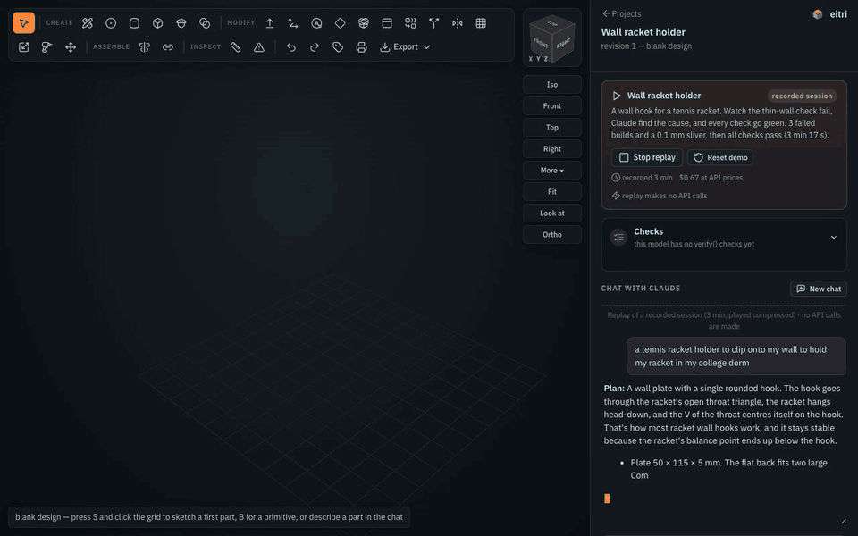
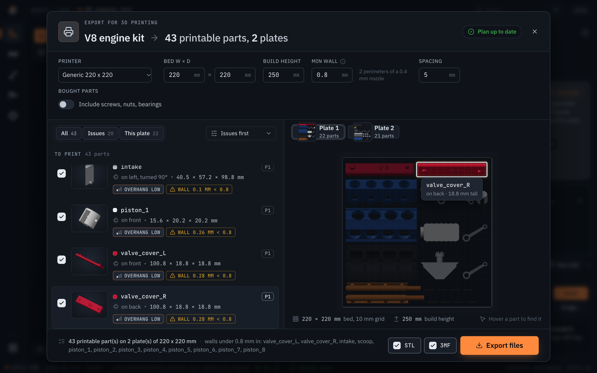
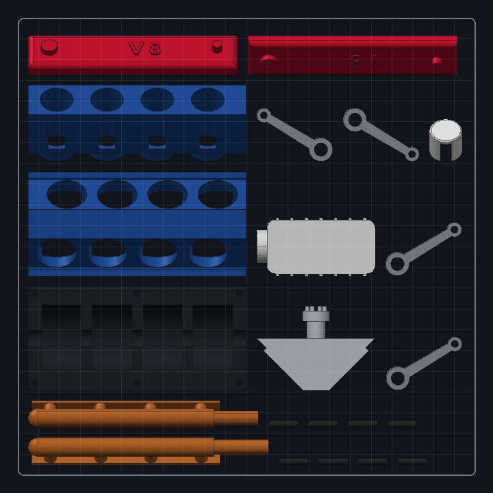
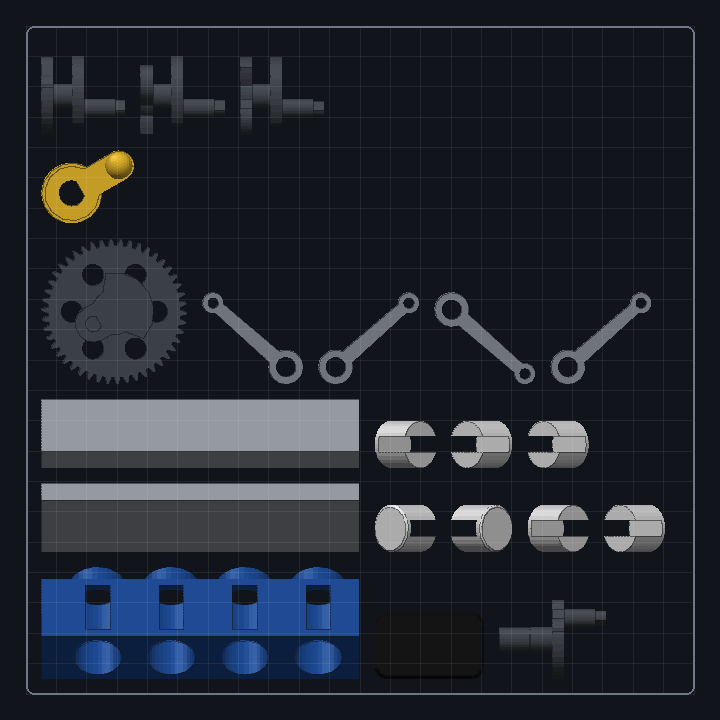
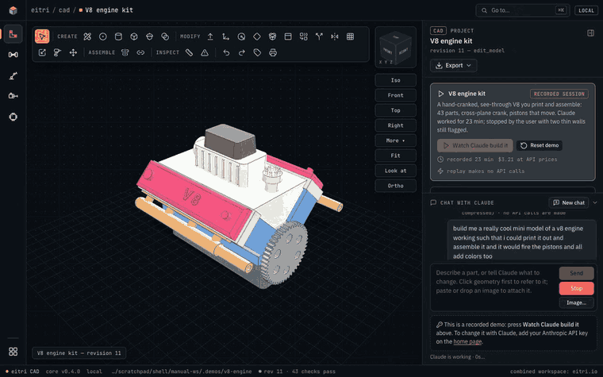
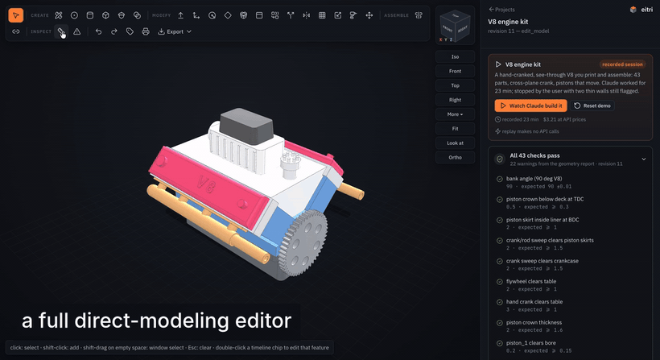
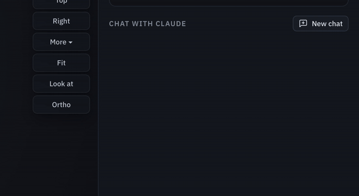
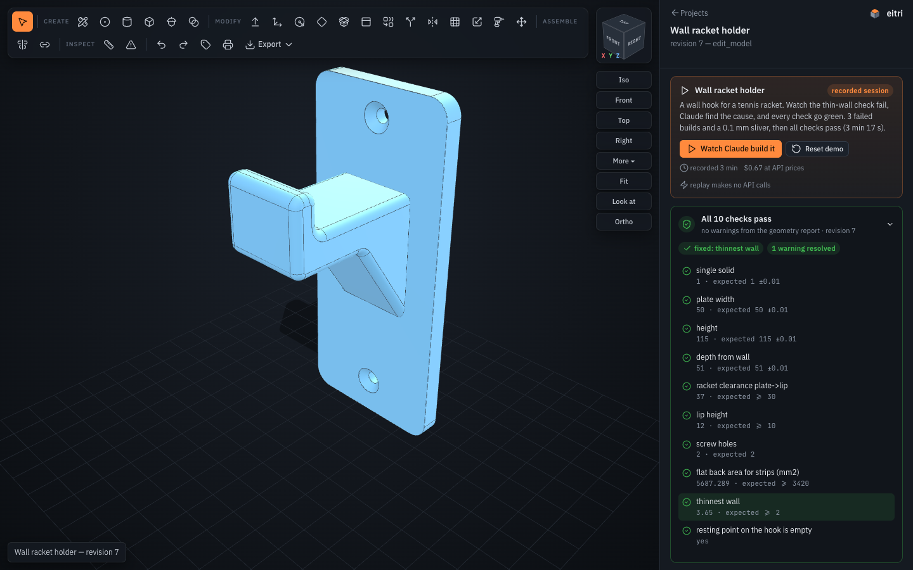

# eitri

**A local AI CAD agent.** Describe a part in plain language; Claude models it as a parametric
[build123d](https://github.com/gumyr/build123d) (OpenCASCADE) model, builds it, **measures it against your
request**, looks at it, fixes what fails, and hands you STEP / STL / 3MF / GLB files. Then keep going in a
Fusion-style 3D editor in your browser, by hand or by chat: both edit the same model.

[Install](#quickstart) · [Limitations](#limitations) · [License](#license)

<!--
  STILL TO RECORD in the app shell (the hero, the V8 build, the checks card and the print dialog are re-shot;
  scripts/record-demo.md has the recipes):
  1. editor tour (docs/editor-tour.gif): still shows the editor before the shell.
  2. manual drag, then the agent continues (docs/edit-agent-loop.gif / .mp4): still the old editor; needs a key.
-->


<sub>A real recorded session (the Wall racket holder demo, which anyone can replay without a key), played back
in the editor: the plan, Claude writing the model, the failed builds, the fix, all 10 checks passing. 3 min 17 s
of work in 18 s.</sub>

Every build comes back to the agent as a **geometry report** (bounding box, volume, every hole with diameter,
depth and through-or-blind, thinnest wall and knife edges, interferences and clearances between parts, the
model's own `verify()` checks) and a **4-view review image**. The agent cannot "forget" to check its work:
the checks are part of the build, and a failing check is fixed in the geometry, never deleted.

## Quickstart

```sh
git clone https://github.com/SiddhuYen/eitri eitri && cd eitri && ./install.sh
eitri
```

`install.sh` installs [uv](https://docs.astral.sh/uv/) if needed, installs eitri with Python 3.12, the CAD
kernel and Claude Code (the binary inside Anthropic's `claude-agent-sdk` package, downloaded from PyPI at
install time; eitri does not ship it), checks the install (`eitri doctor`) and tells you what to run.
`eitri` opens http://127.0.0.1:8765 in your browser. Already have uv?
`uv tool install --python 3.12 git+https://github.com/SiddhuYen/eitri` does the same in one line.
The package is named `eitri-cad` (the name `eitri` was taken on PyPI); the command and the Python import
are both `eitri`.

**Setting it up with an AI agent?** Point it at [AGENTS.md](AGENTS.md): exact commands and expected output
for every step.

> **See it in action without a key.** The home page opens with three demo projects (a 43-part V8 engine kit, a wall
> racket holder, a marble maze) and the real Claude sessions that made them. "Watch replay" plays a session
> back in the editor (the chat, every tool call, the model stepping through each revision, the checks going
> from red to green) with no API calls. Orbit them, edit them, export them: everything but chatting with
> Claude works without a key.

## Your API key, costs, privacy

eitri uses **your own Anthropic API key**; requests are billed to it by Anthropic. Paste it on the home page
or run `eitri key set` (it is checked with one free API call and stored in your user config folder,
readable only by you, never in a project). `ANTHROPIC_API_KEY` in the environment works too.

- **Cost, measured:** about **$0.24 per request** on average across the 22-task benchmark (range $0.07 to
  $1.10 per task). Long design sessions cost more: the recorded V8 engine session in the demos cost $3.21.
- **API key only:** eitri drives Claude Code with `--bare` and your key, so a Claude.ai subscription
  logged in on the same machine is never used.
- **Local only, no telemetry.** The editor, the CAD kernel and your projects stay on this computer; the
  server answers only this machine. The only network calls eitri makes are to Anthropic's API, with your
  key (Claude Code runs with its telemetry, error reporting and update checks turned off).
  Fonts, icons and three.js are bundled; the pages fetch nothing from the internet.

## Export for 3D printing

**Print** in the editor's toolbar (or `eitri print <project>`) turns a design, assembly or not, into the
files a slicer wants:

- **Decompose:** every solid part is listed; bought parts (screws, nuts, washers, bearings, inserts, anything
  with a metal material) are listed but left out by default, with a toggle.
- **Orient:** each part gets its best of six orientations, scored on its surface triangles (overhangs on
  curved faces count) with slender towers penalised; overhang risk is reported, and walls thinner than your
  threshold (default 0.8 mm, two perimeters of a 0.4 mm nozzle) are flagged with the measured value.
- **Plate:** parts are packed onto as many plates as your bed (default 220 x 220 mm) needs.
- **Export:** each part and each plate as STL and 3MF, plus one zip. Every mesh is checked before it is
  written (closed, manifold, consistently wound, the solid's volume) and every file is read back and checked
  again; a part that fails is not written, and the dialog says which and where.



On the V8 demo: **43 printable parts, 2 plates** of 220 x 220 mm, all 43 written and verified in about
3 s after a 3 s plan; 12 parts are flagged with walls under 0.8 mm (the model's own report flags them too).

| Plate 1 | Plate 2 |
|---|---|
|  |  |

## Use

`eitri` (no arguments) opens the **local website**: your projects (in `~/eitri-projects`, or
`eitri web <folder>`), the demos, and a box to describe a part. Press **Create with Claude** and the
project opens in its 3D editor while Claude models it; its steps, the review renders it checks and its
replies stream into the chat beside the model. Keep talking to change it, click geometry first to point at
something, paste or drop a photo or sketch to attach it, press **Stop** (or Esc) to halt a turn (Claude keeps
the conversation) or **New chat** to start over; every direct-modeling tool works alongside. **Start blank**,
**Import a file…** (STEP, IGES, STL, OBJ, 3MF, PLY or a model .py) and **Open a folder…** start projects
without a prompt. Each project keeps its conversation, so it is still there after a restart.

Every page shares one layout: a top bar with where you are (`eitri / wires / Quad power harness`), a rail with
the five tools (CAD, Wires, Motion, Pneumatics, Firmware; each opens that tool's projects) and your project list
at its foot, and a status bar with the tool, the core version, the project folder and the build's verdict. In a
project the model (or a domain's diagram) fills the canvas; the inspector (checks, parameters, the selection,
revisions) and the chat sit in panels docked on the right. The chat collapses to its header, the panels fold to
a strip for more room, and the Export menu at the top of the inspector lists every file the project can be
downloaded as. Dark by default, light when the system is.



<sub>The 43-part V8 demo: one prompt → Claude writes a 398-line model → all 43 checks pass (a recorded
23-minute session, replayed and compressed to 18 s).</sub>

You watch Claude work as it happens: its thinking (readable summaries; each finished thought stays as an
expandable "Thought for N s"), its reply typing out, the model code streaming into a panel over the 3D view,
each step with a spinner and a timer and, for a build, its stage (building → checking → rendering), and the
new geometry the moment it exists, before the checks and the review render finish. The **checks card** at the
top of the panel shows the verdict of every build and what changed since the last one ("fixed: thinnest
wall", "1 warning resolved"). The CAD engine and Claude start loading when you open a project, so the first
build and the first reply don't wait for them.

The terminal works too:

```bash
eitri chat ~/parts/knob                        # the REPL (also: eitri <folder>)
eitri chat -p "a 30 mm knob for a 6 mm D-shaft" # one shot, prints the file paths
eitri build knob.py --set diameter=35           # rebuild + report, no LLM
eitri view knob.py --section XZ:0               # extra renders, no LLM
eitri build vendor_part.step                    # report + review image of any existing STEP
eitri print ~/parts/knob --bed 250x210          # 3D-print export, no LLM
eitri bom ~/eitri-projects/quad                 # a wire-harness project's BOM and cut list, no LLM
eitri serve ~/parts/knob                        # just the viewer, no chat
eitri doctor                                    # check the install
```

In the REPL, talk to it like Claude Code. Follow-ups edit the same model ("make the holes M5", "add a lid").
Slash commands: `/show` (browser viewer), `/set width=45` (change a parameter and rebuild, no LLM), `/undo`,
`/history`, `/params`, `/export stl 3mf`, `/view section XZ:10`, `/image sketch.png` (attach a reference image
to your next message), `/model`, `/notes`.

## Wire harnesses

eitri also designs **wire harnesses and cable assemblies**, with the same loop: Claude writes a parametric Python
model file, a deterministic kernel builds it, and every build returns a report of pass / warn / fail checks and a
review image that Claude has to fix its work against. Mechanical CAD is untouched; a project is a harness project when its
model file builds a `Harness` (it starts with `from eitri.harness import *`). Nothing extra to install: the kernel,
the diagram layout and the rasteriser are our own code (no WireViz, no Graphviz), in plain Python with Pillow.

```python
from eitri.harness import *

PARAMS = dict(arm_mm=180)

def build(p):
    h = Harness("Quad power")
    batt = h.add(Connector("BATT", "XT60", pins=["+", "-"]))
    esc = h.add(Connector("ESC1", "XT30", pins=["+", "-"]))
    h.net("VBAT", current_A=20, voltage_V=14.8)                      # what the checks grade the wires against
    h.connect(batt["+"], esc["+"], Wire(14, "RD", p.arm_mm), net="VBAT")
    h.connect(esc["-"], batt["-"], Wire(14, "BK", p.arm_mm))
    return h
```

Every build computes: **connectivity** (unconnected pins unless declared NC, several wires on one pin, duplicate wires,
dangling splices, nets shorted at a splice), **ampacity** (each wire against a chassis-wiring AWG table, FAIL over the limit,
WARN within 20%; each connector pin against its catalog rating), **voltage drop** (`V = 2*K*I*L/CM`, K = 12.9 for copper at 75 °C, per net against
`max_drop_pct`, summed along the worst source-to-load path) and **consistency** (one gauge and one colour per net, shields
terminated), plus the model's own `verify()`. It writes a wire-harness diagram (SVG, and the PNG review image with the failing
wires outlined red), a **BOM** (connectors with part numbers, crimp terminals inferred from connector type x populated pins,
wire by gauge and colour with a 10% service loop, splices, labels), a **cut list** (cut length, strip lengths and terminations
at both ends of every wire) and a WireViz-compatible YAML (interop only), all in `out/`.

In the browser a harness project opens a **harness editor** instead of the 3D view: click a wire to change its gauge, colour,
length or net; click a connector to rename pins, change its type from the catalog, add or remove pins; drag connectors around;
click a failing check and the wires it is about light up. Changes are direct edits (`EDITS` in the model file, the same path as CAD
edits) and positions are `LAYOUT` hints, so Claude sees your changes and carries on from them. A demo to start from:
`eitri build eitri/demos/quad-power/quad_power.py` (battery XT60 -> distribution splice -> 4 ESCs at 20 A + a flight controller).

```bash
eitri build harness.py                  # the checks, the diagram, BOM and cut list (no LLM)
eitri bom ~/eitri-projects/quad         # the bill of materials; --cutlist adds the cut list, --csv prints CSV
```

The API, the connector catalog and three worked examples are in `eitri/agent/harness_ref.md`; the agent reads them as its
reference when a project is a harness (and calls `harness_reference()` when a blank project turns out to be one).

## Mechanisms, pneumatics and firmware

Three more domains work the same way as harnesses. Claude writes a parametric model file, a deterministic kernel checks every
build, and the browser opens a domain editor instead of the 3D view. A project's domain comes from its model file's import
(`from eitri.mechanism import *`, `from eitri.pneumatics import *`, `from eitri.firmware import *`). Each domain knows only its own
model. The agent reads that domain's reference (`eitri/agent/<domain>_ref.md`) and rules, and gets a `<domain>_reference()` tool for
a blank project that turns out to be one. Edits made in the editor are `EDITS` and positions are `LAYOUT` hints, as for CAD and harnesses.

**Mechanisms** are links, joints (revolute or prismatic, with limits), actuators (stall torque, speed, travel, mass), point masses
and targets. Every build checks:

- **Reach.** Each target is reachable within the joint limits (bounded inverse kinematics), to the target's tolerance.
- **Torque.** The static gravity load on each joint at its worst sampled pose is graded against the actuator's rated torque. The
  rated torque is estimated as half the stall torque when the datasheet gives none.
- **Speed and limits.** Required joint speeds are within the actuator's, and the joint limits fit inside its travel.
- **Mass.** A mass rollup per link and in total.

It writes a joint/torque table, a mass table and a kinematic diagram (SVG and PNG). The editor has a parameter panel and the
kinematic diagram, where you click a joint to edit its limits or actuator. The demo is a pan-tilt camera mount. Its `heavy`
configuration fails the tilt torque check on purpose. The reference has a 3-DOF arm and the pan-tilt.

```python
from eitri.mechanism import *

def build(p):
    m = Mechanism("Pan-tilt")
    m.link("base", fixed=True)
    m.link("yoke", length_mm=30, mass_g=12, direction=(0, 0, 1))
    m.link("cradle", length_mm=35, mass_g=10)
    servo = Actuator("SG90", stall_kgcm=1.8, speed_deg_s=500, travel_deg=180, mass_g=9)
    m.joint("pan", "base", "yoke", axis=(0, 0, 1), at=(0, 0, 0), limit_deg=(-90, 90), actuator=servo)
    m.joint("tilt", "yoke", "cradle", axis=(0, -1, 0), limit_deg=(-30, 60), actuator=servo)
    m.mass("camera", "cradle", 90, at=(35, 0, 0))
    m.target("ahead", (35, 0, 30))
    return m
```

**Pneumatics** are ISO 1219 circuits: supply, FRL, valves (3/2, 5/2, 5/3), flow controls, cylinders (single- or double-acting),
tubes and silencers, connected port to port. Every build checks:

- **Force.** Cylinder force at the pressure that reaches it, after a 10% friction allowance, against the load in both directions.
- **Speed and flow.** ISO 6358 flow (`C`, `b`) through the whole supply and exhaust path of every stroke, against the required speed.
- **Air.** Consumption per cycle and per minute, including dead volume in the tubes, against the supply.
- **Pressure drop.** The drop across each tube and component on every stroke's path, at the flow that stroke needs.
- **Circuit validity.** A supply exists, every cylinder chamber is fed from it through a valve and can exhaust in some valve
  position, every valve has P supplied and its work ports connected, and no line is dead-headed.

A component or tube without datasheet `C`/`b` is graded with a conservative estimate and the check warns. It writes a BOM
(Markdown and CSV), a cylinder table and an ISO 1219-style schematic (SVG and PNG). The editor shows the component list and the
schematic: edit a cylinder, valve or tube, and drag components around. The demo is a double-acting clamp with meter-out speed
control. It reports one warning on purpose, because its tubes carry no datasheet flow figures. The reference has a single-acting
clamp and a double-acting cylinder with speed control.

**Firmware** is a board (Arduino Uno, Arduino Nano, ESP32), a pinout (each pin with a direction, a role and a name), peripherals
(servo, PWM motor driver, limit switch, serial) and the source files Claude writes. Every build generates `eitri_pins.h` from the
pinout, so the sketch uses `PIN_<NAME>` constants instead of numbers. Then it checks:

- **Compile.** The sketch is compiled headless with arduino-cli for the board. A compile error is a failed check at its file and line.
- **Pinout.** Every pin exists on the board and can do its role (PWM, ADC, interrupt, input-only, forbidden ESP32 flash pins,
  ADC2 with Wi-Fi). No pin is assigned twice, and the Serial pins stay free while Serial is in use.
- **Usage.** The sources use each pin exactly as declared (`pinMode`, `digitalWrite`, `analogRead`, `analogWrite`, servo `attach`),
  and use no pin that is not declared.

It writes the pinout table (CSV and Markdown), a pinout diagram, the header, the sketch folder and the compile log. The editor
has a pinout table you can edit (pin, direction, role, name, board), read-only code panes and the compile result. **eitri never
uploads to a board.** You flash it yourself from the sketch folder in `out/`. The demo and the reference example are a servo sweep.

**arduino-cli is a system dependency of the firmware domain only.** Without it, every firmware build has a failed
`compiles (arduino-cli)` check that says "compiler unavailable" and how to install it; the other checks still run. Install it once:

```sh
brew install arduino-cli          # or: curl -fsSL https://raw.githubusercontent.com/arduino/arduino-cli/master/install.sh | sh
arduino-cli core update-index
arduino-cli core install arduino:avr             # Uno and Nano
arduino-cli lib install Servo                    # if a sketch uses <Servo.h>
# ESP32 (optional):
arduino-cli config init                          # once, if there is no arduino-cli.yaml yet
arduino-cli config add board_manager.additional_urls https://espressif.github.io/arduino-esp32/package_esp32_index.json
arduino-cli core update-index
arduino-cli core install esp32:esp32
arduino-cli lib install ESP32Servo               # if an ESP32 sketch drives a servo
```

eitri finds `arduino-cli` on `PATH`, or at the path in `EITRI_ARDUINO_CLI`.

```bash
eitri build eitri/demos/pan-tilt/pan_tilt.py         # 11 pass, 0 warn, 0 FAIL
eitri build eitri/demos/air-clamp/air_clamp.py       # 20 pass, 1 warn, 0 FAIL
eitri build eitri/demos/servo-sweep/servo_sweep.py   # 11 pass, 0 warn, 0 FAIL with arduino-cli and arduino:avr installed
eitri bom ~/eitri-projects/clamp                     # pneumatics: the bill of materials (--csv)
```

## Direct modeling in the viewer (Fusion-style)

A new project starts as a **blank design**, like Fusion: `eitri ~/parts/thing` opens
an empty grid. Press **S** and click the grid to sketch on the ground plane and extrude
the first part, drop a **primitive** (B), or describe the part in the chat and let
eitri write it - every later edit works the same on either.



<sub>Thirteen seconds of the editor on the V8 demo: combine, mirror, align and mate faces, form bodies, holes
sized from fastener tables, export to STEP / STL / 3MF / drawings / G-code.</sub>

The viewer is a modeling tool, not just a display. Every face, edge and part is
pickable (hover shows what it is: "flat face, normal (0,0,1), 2361 mm²",
"hole/bore Ø5", "convex edge 90°"). The toolbar is laid out like Fusion's:

**Create**
- **Sketch (S)** - click a flat face: the view turns to face it, a grid appears,
  and you draw with clicks that snap to the grid, to the face's corners/midpoints
  and to the sketch's own points. It is a real constrained sketcher: lines and
  polylines (L), rectangles (2-corner R, centre, 3-point), circles (centre C,
  2-point, 3-point), arcs (3-point A, centre), ellipses (E), polygons (G,
  inscribed/circumscribed, any sides), slots (O), splines, points (P) and text (T),
  plus construction geometry (X). Joins and near-level lines get Fusion's automatic
  constraints (coincident, horizontal, vertical); the constraint row adds
  coincident, point-on, H/V, parallel, perpendicular, tangent, equal, concentric,
  collinear, midpoint, symmetric and fix; the **Dimension (D)** tool measures a
  line, arc/circle, two points, two lines (angle) or a point and a line and makes
  it driving - click a dimension label to change it. The panel shows the degrees of
  freedom left ("fully constrained"); a change the constraints cannot meet is
  refused with the conflicting constraint named. **Drag any point or curve** with
  the Select tool (V) and the solver keeps the rest consistent (a corner of a
  rectangle stays a corner; a dimensioned size does not change). Modify tools:
  trim, extend, split, sketch fillet/chamfer, offset, mirror, rectangular/circular
  pattern, project 3D edges/faces into the sketch, SVG import.
  Then **extrude** (drag or type; outward adds, inward cuts; extents: a distance,
  **to the next face**, **to a face** you click, or through all; **symmetric**, a
  **taper** angle, a **thin** wall thickness, flip), **revolve** about the sketch's u/v
  axis, a model axis or a straight edge you click, **loft** through scaled/rotated
  sections at offsets (add as many as you like), **sweep** along edges, or a **rib**:
  an open chain extended in-plane until it meets the part, a thickness across the
  plane (sketch it on an offset plane inside the part). "More…" adds a mirror and a
  pattern ("3x2 10x8" or "6 @ 360") of the profile, and a sketch-plane offset. Esc
  restores your view.
  A quick shape (rectangle, circle, …) that you do not edit is stored as that
  shape; anything you edit is stored as the full sketch (entities, constraints,
  dimensions), which the agent reads, edits (`sketch_op`) and folds into code.
- **Hole (H)** - M2…M12 clearance (close/normal/loose) or tapped (tap drill),
  counterbore / countersink, depth, pattern and mirror; click a flat face to
  place it, or a round face for a radial hole. Hole labels can be clicked to
  change diameters.
- **Boss** - a cylindrical boss or screw standoff (plain Ø + hole, heat-set insert,
  self-tapping, clearance; height, hole depth) standing where you click on a flat face.
- **Primitive (B)** - box, cylinder, sphere, torus, cone, hexagon, wedge (ramp) and
  coil (spring), picked from a grid of shapes and **drawn to size**: press on the
  ground grid or on a flat face, drag the footprint (live ghost and dimensions),
  release, move to set the height, click or Enter; type a number at any point for an
  exact size ("30", "24x16"), Esc cancels. A plain click places it at the panel's
  size. A new part, or joined to / cut from the face it is drawn on.
- **Insert (W)** - a screw (socket/button/countersunk/pan/hex head, any length),
  hex nut, washer or ball bearing from the fastener library, placed by clicking a
  hole: the screw's head sits on the surface with the shank down the hole, a nut or
  washer sits on the face, a bearing goes into the bore. They become parts (steel)
  the interference check watches.
- In a sketch, **sweep along edges**: draw the profile on a face the path leaves
  at a right angle, choose *sweep*, click the edges of the path - pipes, rails,
  channels.

**Modify**
- **Push/Pull (P)** - drag a face along its normal with a live ghost (0.5 mm
  snaps; Alt for free). Flat faces move (several selected faces move together);
  holes, bosses and spheres change radius.
- **Surfaces** - from a sketch, make a **surface body** instead of a solid: planar,
  extruded (an open chain becomes a sheet, a closed outline a tube), revolved, swept
  along edges or lofted through sections. Surface parts get their own actions:
  **offset**, **extend** (all free edges, or the edges you select; natural or tangent),
  **trim** by a plane, a face of another part or a sketch profile, **split**, **stitch**
  several sheets into one, **patch** an opening (G0, or G1 tangent to the neighbours),
  **thicken** into a solid and **to solid** (a closed surface). The report lists a
  surface's free edges and the continuity (G0 crease / G1 / G2) of its internal edges.
- **Lip** - a raised lip or a groove along the inner or outer edge of a wall's rim
  (click the rim face; width, height): enclosure lids that locate.
- **Fillet (F) / Chamfer (C)** - click edges (shift adds), drag or type; an end
  radius makes a **variable fillet**, a second size or an angle an unequal chamfer;
  **double-click** an edge to select its whole tangent chain (a rounded pocket's
  outline in one go).
- **Shell (E)** - click the faces to leave open, set the wall; or hollow a part.
- **Combine (J)** - join / cut / intersect two parts (keep the tool or not).
- **Split (X)** - by XY/XZ/YZ at an offset, or by a selected face's plane; keep
  one side or both (the other half becomes a new part).
- **Mirror (I)** - about XY/XZ/YZ through the origin or the part's centre, or
  about a face's plane; joined or as a new part.
- **Pattern (N)** - rectangular or circular copies of a part (joined or as
  parts `name_2`…). Holes and sketch features are patterned from their own
  timeline form.
- **Scale (K)** - uniform or per-axis, about the part's centre.
- Parts can be **renamed**, hidden, **isolated**, deleted (Delete key), made
  **translucent** (opacity slider - see inside a housing) and given a material from
  their panel. Assembly drawings carry a parts list with materials and masses.
- **Thread (T)** - on a hole or a shaft: ISO size, length, cosmetic (reported)
  or modelled (a real helix from bd_warehouse).
- **Move (M)** - drag the gizmo arrows (R rotate, T translate).

**Edit geometry (D)** - the solid-modeling version of Fusion's Edit Form: the
corners of the model get handles you **drag directly** (the orbit stays out of the
way; the faces around the corner deform live as you drag), or click corners, edges
or faces (a filter picks which) and drag the gizmo, or type a move. Corners and
edges move anywhere and the flat faces around them follow - a face whose corners
stop being coplanar becomes a smooth patch, so a box corner pulled up simply stops
being a box. The build works out what each corner can do, so a handle never fails
on you: a round handle moves; a diamond handle sits on a corner that cannot move by
itself and instead moves the hole it belongs to, or pushes/pulls a face meeting there
(a short message says which); a corner of a face with a hole in it slides within
that face; a corner nothing can be done with gets no handle. A flat face can be
moved freely and **tilted** (R on the gizmo, or type an angle), with its neighbours
extending or trimming to meet it; holes and bosses translate. **Delete** removes
the selected faces and heals the body (a fillet, a hole, a boss, a pocket - the
captive floor of a blind hole comes along automatically). Shift-drag on empty space
window-selects many corners/edges/faces at once; dragging a cylinder's rim pushes the
face it bounds. When the kernel cannot do something, the editor says why in a plain
sentence and offers to hand the job to Claude with the selection filled in. Edits
are optimistic: the change stays on screen while the model rebuilds (the revision
chip pulses), further edits queue behind it, and a rebuild never blocks the editor.
Existing **fillets** are
live too: drag a round-over with Push/Pull or type a new radius (chamfers: type a
new size); **Split face** by a
plane lets you push just part of a face; **Separate** turns a part with several
disconnected solids into one part each.

**Form** - Fusion's sculpting environment, as a solid: **Form** in Create makes a smooth
body from a quad control cage (a box, sphere, cylinder or torus with the segment counts
you choose), smoothed by Catmull-Clark subdivision (1-3 levels) and converted to a real
B-spline solid (one patch per cage quad, sewn) so every other tool - fillets, holes,
booleans, drawings, STEP - works on it. Select a form part and press **Edit cage**: the
cage appears over the body with handles at every vertex, face centre and edge midpoint.
Click them (shift adds), drag the gizmo or type a move; **Extrude face** grows a bump
or a limb from a cage face (with a scale for the new face), **Push** moves a face along
its normal, **Insert loop** splits a ring of quads for more control, **Crease** keeps an
edge sharp through subdivision, and **symmetry** mirrors every edit across a plane.
Each action is a `form_edit` op in the timeline; the cage is stored with the model so
the agent can sculpt the same body (`form`, `form_edit`).

**Assemble** - **Align (G)**: click a face on the part to move, then the face to
mate with: flat-to-flat (with offset and flip) or concentric for round faces.

**Sheet metal** - in a sketch choose *sheet metal: base flange* (thickness, inner bend
radius, K-factor) to start a sheet part; select an edge of a sheet face and **Flange…**
(height, angle; an edge of the top face bends up, of the bottom face down; flanges chain
onto flanges), **Contour flange…** (a chain of bends from one edge, typed as
`length@angle` legs - `20@90, 15@-90` is a hat step, `20@90, 15@90` a C return; a
negative first angle starts towards the other face) or **Hem…**; *tab* and *cut*
sketches on a sheet face are carried into the flat pattern. The part panel shows the sheet rules and the flat area, lays out the **flat
pattern** beside the part (bend lines drawn, bend allowance = angle × (r + K t)) and
downloads it as **DXF** with the bend lines on their own layer.

**Assemble** - **Align (G)** mates faces; **Joint** makes an assembly joint between two
parts by clicking a face on each: rigid, revolute (a pin in a hole), slider, cylindrical,
pin-slot, planar or ball, with limits, as-built or mated. The **Joints** panel drives
every joint with a slider (the part and everything jointed onto it move live), animates
it between its limits, and writes the value into the timeline as a drive edit. Motion
links tie two joints by a ratio. Parts can be **grouped** into components and moved
together; **Insert** also places a component from a STEP file or another eitri model.
Assemblies get a **bill of materials** (identical parts counted, CSV download) and
numbered balloons on the drawing's isometric view.

**Parameters & data** - `PARAMS` values may be expressions of other parameters
(`depth="width / 2"`, `height="max(depth / 4, 6)"`), and `CONFIGS = {"small": {...},
"large": {...}}` names variants: pick one in the Parameters panel, `eitri build
--config large`, or ask the agent. The report gives each part's mass properties
(principal moments of inertia) when a material is set. **Revisions** can be
**compared**: the earlier revision is overlaid in red on the current model and the
panel lists which parts were added, removed or changed (volumes, bounding boxes) with
the source diff; the agent has `compare_revisions` too. **Display**: material
appearances (brass, steel, aluminium, PLA, acrylic… with studio reflections), a lens
(focal length) slider, saved named views, and **Render PNG…** for a high-resolution or
transparent image; `eitri view --turntable 36` (or the agent's `view` tool) writes an
animated turntable GIF.

**Inspect** - **Measure (L)**: distance with ΔX/ΔY/ΔZ, minimum distance between
entities, angle between faces; snaps to vertices and midpoints. **Interference**
lists every pair of parts that overlap, with the volume, and shows the overlapping
region in red on the model. Section planes,
exploded view, hole labels, ortho (O), look-at (A), seven named views.

**Timeline** - every direct edit is a chip along the bottom, in order. Click one
to select it (it is then attached to your chat message as "feature #3"),
double-click to open its **Edit feature** form (every parameter of the op, e.g.
a pocket's width/height/position/depth, a hole's size/head/pattern), **Edit sketch**
to reopen the feature's sketch on its face as a constrained sketch (a quick rectangle
becomes four lines with coincident/H/V constraints and two dimensions) and **drag its
points and curves**, change dimensions, add or remove constraints - each drag release
and dimension change rebuilds; a hole's sketch is its circle (drag the centre to move
it, the rim to resize) - and from the panel
**suppress**, move it **earlier/later**, **pattern** it or delete it.
A change that cannot build is refused with the reason and rolled back.

**Meshes & formats** - open an STL/OBJ/3MF/PLY mesh or an IGES file as a model
(`eitri part.stl`), or insert one as a component: meshes are repaired (holes filled,
normals fixed), dense scans **decimated** to a triangle budget (`decimate` on the insert,
`--set decimate=20000` on a mesh model; anything over 200k triangles is reduced to 100k
automatically) and converted to a faceted solid with coplanar facets merged, IGES
surfaces are sewn into solids. Export adds **OBJ** and **IGES**. Sketches import **DXF**
(lines, arcs, circles, polylines with bulges, splines, ellipses; one layer if you like)
and SVG. A **reference image** (a photo or a scan of a napkin sketch) can be placed on a
plane at a known width to trace over.

**Manufacture** - **Toolpaths**: 2.5-D CAM for a part held top-up on a 3-axis mill -
facing, outside/inside contours with holding tabs, pockets found automatically, peck
drilling of the vertical holes, V-bit chamfers - from a tool library with feeds per
material, drawn over the model, with a time estimate and **G-code** for GRBL or LinuxCNC.
**Cut file…**: a laser/waterjet/plasma DXF or SVG of a flat part's outlines with the kerf
compensated (also of a sheet-metal flat pattern). **Print prep…**: the best print
orientation per part (overhang area, support estimate, height, bed contact), the parts
arranged on your bed, and the plate as STL/3MF. The agent has `cam`, `cut_file` and
`print_prep` tools for the same, and the terminal has `eitri cam model.py`,
`eitri cut model.py --kerf 0.3` and `eitri print-prep model.py --bed 220x220`.

**Export** - STEP (verified), STL, 3MF, GLB and the model source, from the
toolbar menu - and an **engineering drawing**: front/top/right views plus an
isometric in third or first angle, ISO or ANSI dimension text, hidden lines dashed,
overall, radius and angle dimensions, centre marks and centrelines, lettered hole
callouts with a hole table, **section views** (`section:XZ@20`: cut, hatched, marked
A-A on the parent view), **half sections** (`halfsection:XZ@0|YZ@0`), **detail views**
(`detail:front@x,y:r:2`, enlarged, circled on the parent), **auxiliary views**
(`aux:1,0,1`), **broken views** (`broken:front@30..70`), notes, leader annotations,
GD&T feature control frames and datums (from the agent's `drawing` tool), **your own
dimensions** (horizontal, vertical or aligned between two points of a view, plus
**chain** and **baseline** groups; `dims` on the tool, `--dims` on the CLI), balloons
and a parts list for assemblies, and a title block with the projection symbol, as
SVG, DXF or **PDF** (tick "show the engineering drawing" in
the sidebar to see it live) or DXF with VISIBLE/HIDDEN/TEXT layers. The agent
makes one when you ask (`drawing` tool) and gets a PNG preview of the sheet back so
it can check its own layout, and `eitri drawing model.py` does it
from the terminal. Parts can be given a **material** (PLA, PETG, ABS, nylon, resin,
aluminium, steel, brass…) and a colour; the report and the parts list then show
their mass. Individual faces take a colour of their own (**Colour…** in the face panel,
the `appearance` op), kept through later edits and carried into the GLB.

Everything you do becomes a *direct edit* in the model file: an `EDITS` list with
geometric selectors (a plane by normal and position, a hole by axis and radius, an
edge by type and midpoint, a sketch by its face frame), applied after `build()`
on every rebuild - so your edits survive parameter changes, consecutive drags on
the same face merge into one, and the report lists them. The agent sees the same
list: it can change an edit you selected (`update_edit`), remove one, or - with
**Fold into code** - rewrite them all into proper parameters and construction
steps (pattern -> `GridLocations`, mirror -> `mirror(...)`, shell -> `offset(...)`,
revolve -> `revolve(...)`, thread -> `IsoThread`, a dragged corner ->
`move_vertices(shape, near=[(x, y, z)], delta=...)` from the library, ...).



<sub>Stretch the plate by hand, tell Claude to continue: it reads your edits, adds the holes, then builds a hook
on the circle you sketched and writes new checks for it ($0.61 of API usage, a real session;
[MP4](docs/edit-agent-loop.mp4)).</sub>

For anything else, click the geometry and type in the chat box ("make this hole
M5 and counterbore it", "this wall is too thin, 3 mm please"): the message goes
to the same agent session as the terminal, with the exact geometry attached
("Selected in the viewer: face plate:f7: cylinder, radius 2.5, concave: a
hole/bore, part of hole Ø5 depth 6 through, centre (20, 0, 3)"), and the agent
edits the parametric model. The terminal shows browser messages too, and the
revisions list lets you jump back to any build.

## The model file

One short Python file, no decorators, no cache, no sidecars:

```python
from eitri import *

PARAMS = dict(width=60.0, depth=40.0, thickness=5.0, hole_d=4.5)

def build(p):
    plate = Box(p.width, p.depth, p.thickness, align=(Align.CENTER, Align.CENTER, Align.MIN))
    plate = round_vertical_edges(plate, 5)
    return cut_holes(plate, [(x, y) for x in (-22, 22) for y in (-12, 12)], d=p.hole_d)

def verify(parts, p, c):
    c.equal("width", parts.size.X, p.width)
    c.count("mounting holes", holes(parts[0], diameter=p.hole_d, through=True), 4)
```

`build(p)` returns build123d geometry (or a dict of named parts for an
assembly). `verify()` is where the agent encodes what you asked for; its results
show up in every report and in the viewer. You can edit the file yourself at any
time - `eitri build` rebuilds it. Builds run in a warm worker process (the CAD
kernel is imported once per session): a parameter change rebuilds in about half
a second, a crash or runaway model just restarts the worker, and nothing is
cached on disk.

`from eitri import *` gives you build123d, the measurement helpers (`holes`,
`min_wall`, `min_distance`, `overlap_volume`, ...) and the **feature library**:
tested helpers for the things that are easy to get subtly wrong - metric screw
clearance/tap/counterbore/countersink holes (`cut_holes`, `screw_hole_cutter`),
heat-set insert bosses and standoffs, nut pockets, slots, ribs and gussets,
embossed/debossed text, patterns, shelled boxes, two-part enclosures with lips
and screw bosses (`enclosure`), involute spur gears, real ISO threads, screws,
nuts, washers and ball bearings (via bd_warehouse), bearing pockets.

## What the automatic checks catch



Things that went wrong during development and are now caught by the build, not by
hoping the agent notices:

- **Slivers and feather edges.** A cable slot meeting a slanted back left a
  0.28 mm sliver; the agent called it "just a corner" and deleted its own check.
  The wall scan now samples just inside every planar face along its edges
  (deterministic, not luck), knife edges under 30° are listed, and the prompt
  forbids weakening a check.
- **STEP files that lose geometry.** OCCT's STEP writer silently drops faces built
  on offset curves (rounded text outlines, offset sketches): a lid with embossed
  text came back from the file as loose faces. Export converts such parts to
  NURBS and re-imports the file to prove every part is still a solid with the
  right volume.
- **Counterbores through thin plates.** A full socket-head counterbore in a 5 mm
  plate would cut clean through; `cut_holes` keeps 1.5 mm of floor and says so.
- **Interference, wrong hole sizes, missing features.** Every pair of parts whose
  bounding boxes come close is checked for overlap and clearance (no close pair is skipped, and a part
  buried wholly inside another counts as a collision); holes are listed with diameter, depth and through/blind so
  "four M4 clearance holes" is a number, not a claim.

Measured on the benchmark plate (M2 Mac, warm): reference cadgen rebuild 0.17 s
(its global daemon + content store), eitri parameter tweak 0.20 s (a per-session
worker, nothing on disk), eitri agent build with analysis + 4-view render 2.2 s.

Known limitations: the wall scan is still a sample (dense, but not a proof);
`min_wall` and interference on large meshing gears take ~10-20 s; threads are
real helical geometry and slow to boolean; the Claude Code backend's startup
adds a few seconds per session.

## Speed

Measured on an Apple-silicon Mac with the CAD engine already loaded (it starts loading when you open a
project):

| What | Time |
|---|---|
| Change a parameter (no LLM) | about 0.5 s |
| Full build of a simple part: build, checks, review render | about 1 s (a small clip: 0.9 s) |
| 3D view of a new build (shown before the checks finish) | 0.1 s for small parts, 2.5 s for the 43-part V8 |
| 43-part V8 assembly, full build with interference and clearance checks | about 21 s |
| One request handled by Claude, end to end (22-task benchmark) | 89 s on average, 52 s median |
| Cost per request at API prices (same benchmark) | $0.24 on average ($0.07 to $1.10) |

Most of a request's time is Claude thinking, not CAD work; the chat streams Claude's thinking and the model
code as they are written, so the screen is never blank.

Direct edits (push/pull, fillets, moves, primitives, parameter changes) never call the LLM: they go editor →
`EDITS`/`PARAMS` → kernel. Measured server-side on the 43-part V8 demo, request sent → geometry ready /
request sent → checks done, before and after the build-reuse and caching work (October 2026):

| Direct edit on the V8 | before | after |
|---|---|---|
| Fillet an edge | 8.1 s / 23.2 s | 0.8 s / 3.0 s |
| Move a face | 7.3 s / 22.4 s | 1.5 s / 3.2 s |
| Push/pull a face | 6.0 s / 26.1 s | 4.9 s / 7.2 s |
| Move a part | 7.9 s / 23.2 s | 0.6 s / 2.4 s |
| Change a parameter | 8.2 s / 23.9 s | 4.9 s / 6.6 s |

The same edits on a one-part plate: 0.3-0.5 s before, 0.2-0.4 s after. In the browser, from the mouse
release to the new geometry on screen, the V8 went from about 37 s to 5.5-14 s and the plate from 1.1-1.8 s
to 0.4-0.7 s, measured in a software-rendered headless browser that spends seconds loading the V8's
3,900-node view; a browser with a GPU is close to the server numbers.

## Accuracy

- Geometry is exact B-rep (OpenCASCADE), not meshes: dimensions are what the code says.
- The benchmark below: 22 tasks scored by checkers that read only the produced STEP file. eitri solved
  22/22; the same model driving Claude Code with the text-to-cad plugin solved 20/22 (its misses: walls it
  never measured). A blind judge preferred eitri 9 times, the baseline 3 times, 10 ties.
- Hole detection was cross-checked against OCCT's reference classifier: 1,490 holes and 51,474
  near-surface points, no mismatches. STEP export is verified by reading the file back (every part a solid
  with the right volume). Print meshes are checked closed, manifold and at the solid's volume.

The benchmark was built and run by eitri's authors, each task once, and the judge was also Claude: strong
evidence, not independent proof.

## Limitations

- The wall-thickness check is a dense sample (about 600 rays plus samples along every edge), not a proof.
- Imported meshes stay faceted: an STL becomes a solid of flat facets, not smooth cylinders.
- Big assemblies are slower: the clearance check measures every pair of parts whose boxes come close
  (about 9 s of the V8's 21 s build); farther pairs are counted, not measured.
- Not included: FEA/thermal/modal simulation, generative design, electronics/PCB, lathe and multi-axis CAM,
  DWG/SAT/native Fusion or SolidWorks import, cloud sharing, photorealistic rendering, true T-splines (the
  Form workspace is subdivision-based). CAM is 2.5-axis; sheet-metal corner reliefs are basic.
- Needs an Anthropic API key to chat (billed to you); everything else works without one. Tested on macOS
  (Apple silicon); Linux should work (the same packages exist); Windows is untested.
- Print orientation tries the six axis-aligned orientations only; plate packing is shelf packing, not a
  nesting optimiser.
- Direct edits reuse the previous build's geometry when only the `EDITS` list changed. A model whose
  `build(p)` reads files outside its folder, uses randomness or the clock may be served stale geometry:
  `EITRI_REUSE_BUILD=0` turns that reuse off (`EITRI_REUSE_EDITS=0` the reuse of earlier edits).

## Compared to text-to-cad

[earthtojake/text-to-cad](https://github.com/earthtojake/text-to-cad) is the best
open text-to-CAD system we know of; eitri was built by studying it. Where it
falls short, and what eitri does instead:

| | text-to-cad | eitri |
|---|---|---|
| Shape | A skill pack + 68k-line Python runtime (`cadgen`) for other agents (Claude Code, Codex, Cursor...) | A standalone CAD agent with its own REPL and viewer; also usable as a library |
| Install | uv + per-host plugin marketplaces, pinned Python 3.13, telemetry on by default, update nags | `uv tool install`; no plugins, no telemetry |
| Model contract | `@step/@stl/@glb` decorators, parameterless models, a content-addressed store with a build daemon, freshness gates, sidecar JSON, link-vs-component rules | `PARAMS` + `build(p)` + `verify()`; builds are fast enough that nothing needs caching |
| Verification | Up to the agent: write ad-hoc scripts in `tmp/`, remember to snapshot | Automatic on every build: validity, holes, thinnest wall, interferences, plus the model's own checks; failures are flagged to the agent |
| Visual review | Playwright + headless Chromium snapshots | A numpy software renderer: 4-view contact sheet in ~1 s, no browser |
| Standard features | Agent recalls screw sizes etc. from memory | Tested library with ISO fastener/insert/bearing tables, gears, threads, enclosures |
| Parameter tweaks | Edit code and rebuild | `/set width=45` or sliders in the viewer: no LLM call, ~0.5 s rebuild (a warm kernel worker per session, no global daemon) |
| Revisions | None (git) | Every build is a numbered revision; `/undo`, `/history`, restore from the viewer |
| Editing geometry directly | Click a face in its viewer to paste a reference like `#o1.f7` into your prompt | Fusion-style direct modeling: push/pull, a constrained sketcher (lines/arcs/circles/ellipses/polygons/slots/splines/text, constraints, driving dimensions, DOF, solve-on-drag, trim/extend/split/offset/mirror/pattern/fillet, projected edges, SVG import) + extrude/cut/revolve/loft/sweep, holes with fastener sizes, primitives, shell, combine, split, mirror, patterns, scale, threads, fillet/chamfer, align/mate, measure, a timeline with edit-feature forms and suppress/reorder, undo, materials and mass, export - all tracked as `EDITS` the agent can read, change and fold into code |
| Agent instructions | SKILL.md + ~2,600 lines of references | One prompt + a build123d reference whose every snippet is executed by the test suite |
| Evidence | - | A benchmark of 22 tasks scored by geometry checkers, run against both systems |

## Benchmark

`bench/tasks.py` holds 22 requests (plate, L-bracket, two-part enclosure,
flange, spur gear, stepped shaft, phone stand, cable clip, print-in-place hinge,
knob, threaded bottle cap, heatsink, V pulley, divided tray, Raspberry Pi 4 case,
NEMA 17 motor bracket, Arduino Uno plate, embossed name tag, M8 hex bolt, slotted
bracket, 608 bearing housing, meshing gear pair); two of them also carry a
follow-up edit sent in the same session. Each has a checker
that reads only the produced STEP: dimensions, hole counts/diameters/positions,
wall thickness, interference, features. `bench/run.py` runs a task through
eitri or through the baseline (headless Claude Code with the text-to-cad
plugin installed, same model, same prompt) and scores the result identically.

Results (Claude Opus 5.5 at effort high for both, 2026-10-11; full tables and
per-check verdicts in [`bench/RESULTS.md`](bench/RESULTS.md)):

| | baseline (Claude Code + text-to-cad) | eitri |
|---|---|---|
| Tasks solved (all checks pass) | 20 / 22 | **22 / 22** |
| Mean check score | 0.99 | **1.00** |
| Time per task (CLI-measured) | 228 s (median 52 s; one task 44 min) | **89 s** (median 52 s) |
| Cost per task (list-price equivalent) | $0.44 | **$0.24** |
| Follow-up edits in the same session | 2 / 2 | 2 / 2 |
| Blind pairwise judge (Opus, vision), 22 pairs | preferred 3 | **preferred 9** (10 ties) |
| Judge mean fidelity / engineering / overall | 8.5 / 7.5 / 7.6 | 8.5 / **7.9** / **8.0** |

The baseline's two misses are walls it never measured (1.84 mm and 1.32 mm where
2 and 1.6 mm were asked) and then reported as fine. eitri's automatic report
caught the same class of problem in its own work (a 0.28 mm sliver on the phone
stand) and the agent rebuilt until the thinnest wall was 3.2 mm. The baseline is
genuinely strong on single-turn parts; the gap is self-verification, not raw
modelling (both use the same LLM). Four eitri tasks were re-run after product
fixes found during the run (a STEP-writer bug and a stricter wall warning); the
first attempts are listed in RESULTS.md.

## How it works

```
eitri/
  model.py      the contract: PARAMS, build(p), verify(); Parts; Checker
  kernel.py     build a model file in a subprocess (timeouts, crash isolation), export STEP/GLB/STL/3MF
  measure.py    holes, bosses, min_wall (ray casting), distances, overlaps, mass
  report.py     the automatic report + text summary
  render.py     numpy rasterizer: contact sheets, sections, exploded views
  lib/          the feature library (fasteners, features, enclosure, bearings, parts)
  agent/        tools.py (the tool set), prompt.md, build123d_ref.md, <domain>_prompt.md / <domain>_ref.md, claude_cli.py (headless
                Claude Code backend over MCP), api_backend.py (Messages API backend)
  viewer/       the editor: local HTTP server + three.js page (three.js vendored)
  web/          the local website (home page, projects, demos, API-key setup) and the shared assets
  printexport.py  3D-print export: decompose, orient, plate, verified STL/3MF
  extensions.py the plugin point: registered hooks add checks to every build (and guard what a model declared)
  harness/      wire harnesses: the typed model, checks, report, diagram (SVG + PNG), BOM / cut list / WireViz YAML
  mechanism/    mechanisms: links, joints, actuators; reach (IK), worst-pose torque, speed, limits, mass; kinematic diagram
  pneumatics/   ISO 1219 circuits: force, ISO 6358 flow, air consumption, pressure drop, validity; schematic, BOM
  firmware/     board, pinout, peripherals, sources; pin checks, arduino-cli compile (never uploads); pinout diagram
  domains.py    the registry of non-CAD domains (one `domain.py` per package); checks.py and diagram.py are shared by them
  demos/        the bundled demo projects and their recorded sessions (agent/replay.py plays them)
  config.py     the API key (user config folder)
  doctor.py     `eitri doctor` and `eitri key`
  cli.py        the REPL and subcommands
bench/          tasks, runner, results
tests/          everything above, including every snippet of the build123d reference
```

**Extensions.** Extra checks can be plugged into every build without changing eitri: a function registered with
`eitri.extensions.register(name, fn)`, named in `EITRI_EXTENSIONS=module[,module:setup...]`, or published as an
`eitri.extensions` entry point gets a `BuildContext` (the model module, what it built, the report so far) after each
build and returns checks that join the report beside `verify()`; it can also return data for `result.json` and a
`guard`, a dict of counts the project remembers per model file and fails a later build for if they shrink (only
`Project.release_guard(name)` lowers it). See `eitri/extensions.py`.

Development: `uv venv --python 3.12 && uv pip install -e '.[dev]' && pytest`. The demos are rebuilt
from recorded projects with `scripts/make_demos.py`.

## License

eitri is licensed under the [Functional Source License, Version 1.1, MIT Future License](LICENSE.md)
(FSL-1.1-MIT): you may use, modify and redistribute it for any purpose except offering a competing
commercial product or service; each version becomes MIT-licensed two years after it is released. Bundled
third-party assets keep their own licenses: three.js (MIT, `eitri/viewer/vendor/three/LICENSE`), IBM Plex
Sans and JetBrains Mono (SIL OFL 1.1, `eitri/web/assets/design/fonts/`), Lucide icons (ISC,
`eitri/web/assets/LICENSE-lucide.txt`).
